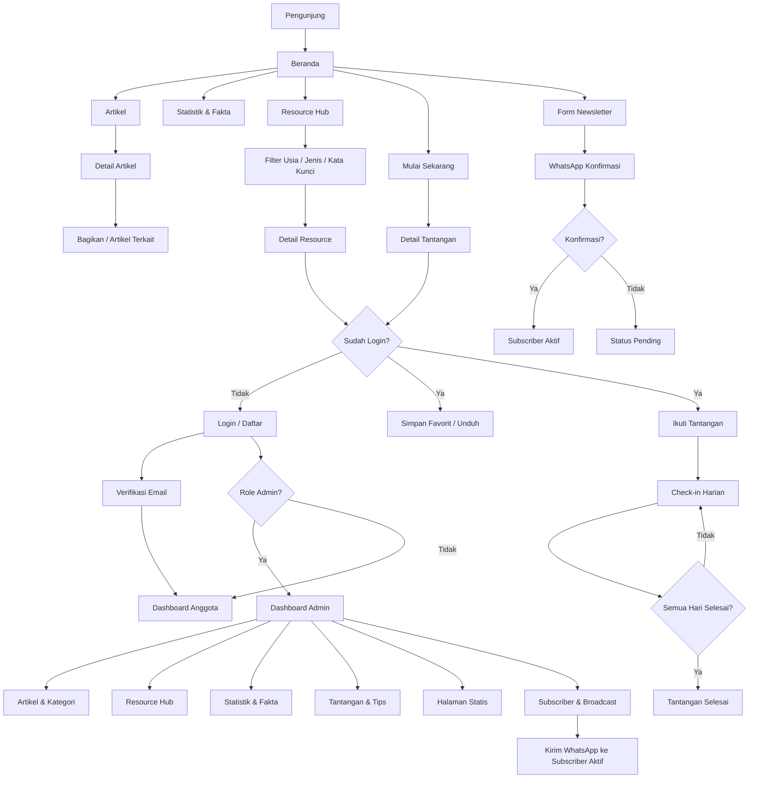

# Masyarakat Literasi

---

## 1. Ringkasan & Tujuan Aplikasi

*Bagian ini menjelaskan gambaran umum proyek agar dipahami bersama oleh pemilik ide/klien dan tim pengembang.*
- **Nama Aplikasi**: Masyarakat Literasi
- **Penjelasan Singkat**: Website edukatif yang meningkatkan kesadaran tentang pentingnya literasi (membaca, menulis, berpikir kritis, digital, dan informasi) di Indonesia. Pengunjung mendapat artikel, fakta, sumber belajar gratis, serta tantangan kebiasaan 7/21/30 hari yang progresnya tersimpan di akun mereka.
- **Masalah yang Diselesaikan**:
  - Kesadaran masyarakat tentang dampak literasi terhadap kualitas hidup, ekonomi, dan pembangunan sosial masih rendah.
  - Konten literasi tersebar di banyak tempat, sering terlalu akademik, dan sulit ditemukan.
  - Orang yang ingin membangun kebiasaan membaca tidak punya panduan praktis dan penyemangat yang konsisten.
  - Orang tua, pendidik, dan komunitas kesulitan mencari materi yang sesuai kelompok usia.
  - Belum ada pusat informasi tepercaya tentang literasi yang ramah dan modern.
- **Pengguna Aplikasi**:
  - **Pengunjung Umum**: membaca artikel, melihat statistik, menjelajah Resource Hub, berlangganan newsletter, dan menghubungi kami tanpa login.
  - **Anggota Terdaftar (Email & Password)**: mengikuti tantangan 7/21/30 hari, menyimpan progres, check-in harian, dan menyimpan resource favorit.
  - **Admin / Pengelola Konten**: mengelola artikel, kategori, resource, statistik, tantangan, tips, halaman statis, dan subscriber.
- **Target Keberhasilan**:
  - Pengunjung unik per bulan naik konsisten (target awal 10.000 per bulan dalam 6 bulan).
  - Bounce rate di bawah 55% dan rata-rata waktu di situs lebih dari 2 menit.
  - Minimal 2.000 subscriber newsletter dalam 6 bulan pertama.
  - Minimal 500 anggota aktif mengikuti tantangan, dengan tingkat penyelesaian di atas 30%.
  - Skor Lighthouse (Performance, SEO, Accessibility) di atas 90 untuk halaman publik.

---

## 2. Batasan Pembuatan Sistem (Versi Awal MVP)

*Menegaskan fitur apa yang dikerjakan di versi awal dan apa yang sengaja ditunda agar aplikasi cepat selesai dan tidak membengkak.*

### ✅ Yang Dikerjakan:

- Homepage dengan pesan kuat tentang pentingnya literasi.
- Blog/Artikel dengan kategori (Literasi Membaca, Digital, Anak, Menulis, Berpikir Kritis, Informasi), pencarian, dan halaman detail.
- Halaman Statistik & Fakta Literasi Indonesia (kartu angka, grafik sederhana, sumber data).
- Resource Hub dengan filter kategori usia, jenis materi (Buku, Tools, PDF), dan pencarian kata kunci.
- Halaman "Mulai Sekarang": tips praktis dan tantangan 7/21/30 hari.
- Registrasi & login Email/Password (Supabase Auth), profil anggota, progres tantangan, dan check-in harian.
- Tentang Kami, Visi & Misi, Kontak, dan Newsletter subscription (nomor WhatsApp, email opsional).
- Panel Admin: Artikel & Kategori, Resource Hub, Statistik & Fakta, Tantangan & Tips, Halaman Statis (Tentang Kami), Subscriber Newsletter.
- Notifikasi WhatsApp Gateway: konfirmasi langganan, pengingat tantangan harian, dan broadcast newsletter.
- Upload gambar dan file PDF melalui Supabase Storage.
- SEO dasar, aksesibilitas WCAG AA, analytics (Plausible), responsif mobile-first.

### ⛔ Yang Tidak Dikerjakan di Versi Awal:

- Forum/komunitas diskusi.
- Kuis interaktif tingkat literasi.
- Peta komunitas literasi Indonesia.
- Integrasi media sosial lanjutan (selain tombol share dasar).
- Multi-bahasa (English).
- Login sosial (Google, dll.) dan magic link.
- Pembayaran atau fitur berbayar (tidak ada payment gateway).
- Aplikasi mobile native.
- Komentar pada artikel.

---

## 3. Daftar Halaman & Struktur Menu (Pages & Routing)

*Daftar lengkap halaman yang harus dibuat, dikelompokkan berdasarkan peran pengguna.*

### A. Public Area (Tanpa Login)

- `/` (Beranda): hero pesan literasi, statistik ringkas, artikel terbaru, sorotan resource, ajakan tantangan, form newsletter.
- `/artikel` (Daftar Artikel): daftar artikel dengan filter kategori, pencarian, dan paginasi.
- `/artikel/[slug]` (Detail Artikel): konten, penulis, waktu baca, artikel terkait, tombol bagikan.
- `/statistik` (Statistik & Fakta): kartu angka kunci, grafik, daftar fakta, dan sumber data.
- `/resource` (Resource Hub): daftar materi dengan filter kategori usia, jenis materi, dan pencarian.
- `/resource/[slug]` (Detail Resource): deskripsi, tautan/unduhan, kategori usia, tombol simpan favorit (perlu login).
- `/mulai-sekarang` (Mulai Sekarang): tips praktis dan daftar tantangan 7/21/30 hari.
- `/mulai-sekarang/tantangan/[slug]` (Detail Tantangan): deskripsi, jadwal harian, tombol ikuti.
- `/tentang` (Tentang Kami): cerita, visi, misi, nilai, tim.
- `/kontak` (Kontak): form pesan dan informasi kontak.
- `/newsletter` (Berlangganan): form berlangganan lewat WhatsApp.
- `/login` dan `/daftar` (Autentikasi): form Email & Password.
- `/lupa-password` dan `/reset-password` (Pemulihan Akun): kirim dan atur ulang kata sandi.

### B. Member Area (Setelah Login)

- `/dashboard` (Dasbor Anggota): ringkasan tantangan aktif, streak, resource favorit.
- `/dashboard/tantangan` (Tantangan Saya): tantangan aktif dan selesai beserta progres.
- `/dashboard/tantangan/[id]` (Detail Progres): kalender check-in harian dan catatan refleksi.
- `/dashboard/favorit` (Resource Favorit): resource yang disimpan.
- `/dashboard/profil` (Profil & Pengaturan): nama, nomor WhatsApp, preferensi pengingat, ganti password.

### C. Admin Area

- `/admin` (Dasbor Admin): ringkasan jumlah artikel, subscriber, anggota, dan tantangan aktif.
- `/admin/artikel` (Kelola Artikel): tabel, filter status (draft/terbit), tambah/edit/hapus.
- `/admin/artikel/baru` dan `/admin/artikel/[id]/edit` (Editor Artikel): form dengan upload cover dan editor konten.
- `/admin/kategori` (Kelola Kategori): CRUD kategori artikel.
- `/admin/resource` (Kelola Resource): CRUD resource, jenis, kategori usia, upload PDF.
- `/admin/statistik` (Kelola Statistik & Fakta): CRUD data statistik dan fakta.
- `/admin/tantangan` (Kelola Tantangan): CRUD tantangan dan jadwal harian.
- `/admin/tips` (Kelola Tips): CRUD tips praktis.
- `/admin/halaman` (Halaman Statis): edit konten Tentang Kami, Visi & Misi.
- `/admin/subscriber` (Subscriber Newsletter): daftar, filter status, ekspor CSV, hapus.
- `/admin/broadcast` (Broadcast WhatsApp): tulis dan kirim newsletter ke subscriber aktif, lihat riwayat.
- `/admin/pesan` (Pesan Kontak): daftar pesan masuk dari form kontak.

---

## 4. Pedoman UI/UX & Design System

*Panduan visual konkret agar AI coding assistant tidak membuat UI yang kaku atau default.*
- **Skema Warna**:
  - Background: HSL(0, 0%, 100%)
  - Surface/Muted: HSL(40, 20%, 98%)
  - Foreground (teks utama): HSL(220, 15%, 12%)
  - Muted Foreground: HSL(220, 8%, 46%)
  - Border: HSL(220, 13%, 91%)
  - Primary (aksen): HSL(160, 45%, 28%) hijau tua yang tenang
  - Primary Foreground: HSL(0, 0%, 100%)
  - Accent (sorotan kecil): HSL(38, 85%, 52%)
  - Destructive: HSL(0, 70%, 45%)
  - Dark mode tidak wajib di MVP.
- **Tipografi**:
  - Heading: 'Playfair Display' (serif elegan, hanya untuk judul besar H1/H2) atau alternatif 'Inter' dengan weight 600 dan tracking rapat. Pilih satu dan konsisten.
  - Body dan UI: 'Inter' (sans-serif), ukuran dasar 16px, line-height 1.7 untuk artikel.
  - Lebar baca artikel maksimal 68ch.
  - Muat font via `next/font` dengan `display: swap`.
- **Aturan Komponen**:
  - Border 1px sangat tipis (`border-border`), tanpa shadow berat; shadow hanya `shadow-sm` pada dropdown/dialog.
  - Sudut `rounded-md` (6px) untuk tombol, input, dan kartu.
  - Tombol utama solid Primary; tombol sekunder outline; tautan teks dengan underline tipis saat hover.
  - Kartu artikel tanpa latar berwarna: gambar, kategori kecil huruf kapital, judul, ringkasan, meta.
  - Jarak antar-seksi besar (`py-20` desktop, `py-12` mobile), kontainer maksimal `max-w-6xl`.
  - Fokus keyboard jelas (`ring-2 ring-primary ring-offset-2`), kontras minimal 4.5:1.
  - Ikon: Lucide, stroke 1.5.
- **Nuansa & Vibe**: Minimalis, bersih, fokus tipografi, banyak whitespace, tenang, dan inspiratif seperti majalah bacaan modern. Animasi halus saja (fade/transition 150-200ms), menghormati `prefers-reduced-motion`.

---

## 5. Pembagian Hak Akses Pengguna

*Tabel hak akses yang menentukan siapa saja yang boleh melihat, mengedit, atau mengelola data.*

| Menu / Halaman | Publik (Tanpa Login) | Anggota (Login) | Admin |
| :--- | :---: | :---: | :---: |
| Beranda, Artikel, Statistik, Tentang, Kontak | ✅ | ✅ | ✅ |
| Resource Hub (lihat & filter) | ✅ | ✅ | ✅ |
| Simpan Resource Favorit | ❌ | ✅ | ✅ |
| Lihat Daftar & Detail Tantangan | ✅ | ✅ | ✅ |
| Ikuti Tantangan & Check-in Harian | ❌ | ✅ | ✅ |
| Dasbor Anggota & Profil | ❌ | ✅ | ✅ |
| Berlangganan Newsletter | ✅ | ✅ | ✅ |
| Kelola Artikel & Kategori | ❌ | ❌ | ✅ |
| Kelola Resource Hub | ❌ | ❌ | ✅ |
| Kelola Statistik & Fakta | ❌ | ❌ | ✅ |
| Kelola Tantangan & Tips | ❌ | ❌ | ✅ |
| Kelola Halaman Statis | ❌ | ❌ | ✅ |
| Kelola Subscriber & Broadcast | ❌ | ❌ | ✅ |
| Pesan Kontak | ❌ | ❌ | ✅ |

---

## 6. Alur Kerja dan Fitur Utama

*Menjelaskan cara kerja setiap fitur utama dalam bahasa yang mudah dipahami serta aturan logikanya.*

### A. Autentikasi Anggota (Email & Password)

1. **Cara Kerja**: Pengunjung membuka `/daftar`, mengisi nama, email, dan kata sandi, lalu menerima email verifikasi dari Supabase. Setelah verifikasi, anggota login di `/login` dan diarahkan ke `/dashboard`. Lupa kata sandi ditangani di `/lupa-password`.
2. **Aturan Sistem**:
   - Kata sandi minimal 8 karakter, mengandung huruf dan angka.
   - Email unik; profil dibuat otomatis di tabel `profiles` lewat trigger database.
   - Role default `member`; role `admin` hanya diubah manual oleh admin lewat database.
   - Sesi dikelola Supabase SSR (cookie) dan dicek di middleware.

### B. Artikel & Kategori

1. **Cara Kerja**: Pengunjung membuka `/artikel`, memfilter kategori atau mencari kata kunci, lalu membuka artikel. Admin menulis artikel di `/admin/artikel/baru`, mengunggah cover, memilih kategori, dan menyimpan sebagai draft atau terbit.
2. **Aturan Sistem**:
   - Slug otomatis dari judul dan harus unik.
   - Hanya artikel berstatus `published` yang tampil publik.
   - Waktu baca dihitung otomatis (200 kata per menit).
   - Cover maksimal 2 MB (JPG/PNG/WebP).
   - Penghapusan kategori ditolak jika masih dipakai artikel.

### C. Statistik & Fakta Literasi

1. **Cara Kerja**: Halaman `/statistik` menampilkan kartu angka kunci, grafik tren, dan daftar fakta menarik beserta sumbernya. Admin mengelola datanya di `/admin/statistik`.
2. **Aturan Sistem**:
   - Setiap data wajib punya nama sumber, tahun, dan URL sumber (opsional).
   - Tipe data: `metric` (angka kunci), `fact` (fakta teks), `chart` (deret data JSON).
   - Admin mengatur urutan tampil dan status aktif.

### D. Resource Hub

1. **Cara Kerja**: Pengunjung membuka `/resource`, mengetik kata kunci, memilih kategori usia (Anak, Remaja, Dewasa, Semua Usia) dan jenis materi (Buku, Tools, PDF). Hasil diperbarui langsung dan filter tersimpan di parameter URL. Anggota dapat menyimpan resource ke favorit.
2. **Aturan Sistem**:
   - Pencarian berbasis kata kunci pada judul dan deskripsi (ILIKE atau full-text search PostgreSQL).
   - Filter dapat dikombinasikan dan dibagikan lewat URL (`?q=&usia=&jenis=`).
   - Jenis PDF: file diunggah ke Supabase Storage (maksimal 10 MB) dan diunduh lewat signed/public URL; jenis Buku dan Tools memakai tautan eksternal.
   - Jumlah unduhan/klik dicatat di kolom `download_count`.

### E. Tantangan 7/21/30 Hari & Tips

1. **Cara Kerja**: Di `/mulai-sekarang` pengunjung melihat tips praktis dan daftar tantangan. Anggota menekan "Ikuti Tantangan", lalu setiap hari melakukan check-in di `/dashboard/tantangan/[id]` dengan catatan refleksi singkat. Streak dan persentase progres ditampilkan.
2. **Aturan Sistem**:
   - Durasi tantangan hanya 7, 21, atau 30 hari.
   - Satu anggota hanya boleh punya satu tantangan aktif per tantangan yang sama.
   - Satu check-in per hari (zona waktu Asia/Jakarta, WIB).
   - Tantangan selesai otomatis saat seluruh hari terisi; jika terlewat, streak kembali ke 0 tetapi progres tidak dihapus.
   - Setiap hari tantangan memiliki tugas harian yang diisi admin di `challenge_days`.
   - Pengingat harian via WhatsApp hanya dikirim jika anggota mengaktifkan pengingat dan mengisi nomor WhatsApp.

### F. Newsletter & WhatsApp Gateway

1. **Cara Kerja**: Pengunjung mengisi nomor WhatsApp (dan email opsional) pada form newsletter. Sistem mengirim pesan konfirmasi berisi tautan verifikasi. Setelah konfirmasi, status menjadi `active`. Admin membuat broadcast di `/admin/broadcast` dan mengirim ke subscriber aktif. Setiap pesan memuat cara berhenti berlangganan (balas "STOP" atau tautan unsubscribe).
2. **Aturan Sistem**:
   - Nomor divalidasi format Indonesia (diawali 08 atau +62, dinormalisasi ke 62xxxx).
   - Double opt-in: tanpa konfirmasi, subscriber tidak menerima broadcast.
   - Pengiriman massal memakai antrean dengan jeda antar-pesan (rate limit) lewat Supabase Edge Function atau route cron.
   - Setiap pengiriman dicatat di `notification_logs` (status: queued, sent, failed).
   - Penyedia gateway bersifat konfigurabel lewat env (contoh: Fonnte atau WABlas); webhook status dipakai bila tersedia.

### G. Kontak, Halaman Statis, & Panel Admin

1. **Cara Kerja**: Pengunjung mengirim pesan lewat `/kontak`; admin membacanya di `/admin/pesan`. Admin mengedit konten Tentang Kami dan Visi & Misi di `/admin/halaman`.
2. **Aturan Sistem**:
   - Form kontak dilindungi honeypot dan rate limit (maksimal 3 pesan per jam per IP).
   - Semua konten rich text disanitasi sebelum disimpan dan ditampilkan.
   - Seluruh rute `/admin/*` dicek role `admin` di middleware dan Server Actions.

---

## 7. Alur Navigasi & Arsitektur Layout

*Peta navigasi alur halaman dan struktur tata letak (layout).*

### Arsitektur Layout (Persisten)

- **Public Layout**: Navbar statis di atas (logo, Artikel, Statistik, Resource, Mulai Sekarang, Tentang, tombol Masuk/Daftar) dan Footer (tautan, newsletter singkat, kontak).
- **Auth Layout**: Halaman sederhana terpusat tanpa navbar penuh untuk `/login`, `/daftar`, `/lupa-password`.
- **Member Dashboard Layout**: Sidebar kiri (fixed; drawer di mobile) dan header kecil dengan menu profil.
- **Admin Layout**: Sidebar kiri berisi seluruh modul admin dan header kecil dengan tombol keluar.

### Bagan Alur (Flowchart)



---

## 8. Kebutuhan Non-Fungsional (SEO, Keamanan, & Performa)

*Syarat wajib agar website siap rilis ke publik (production-ready).*
- **SEO**:
  - Tag `<title>` dinamis, meta description, dan Open Graph/Twitter Card di setiap halaman publik melalui `generateMetadata`.
  - `sitemap.xml` dan `robots.txt` otomatis, canonical URL, serta structured data JSON-LD (`Article`, `BreadcrumbList`, `Organization`).
  - URL bersih berbasis slug.
- **Aksesibilitas (WCAG 2.1 AA)**:
  - HTML semantik, label form, `alt` pada gambar, navigasi keyboard penuh, skip-to-content, kontras minimal 4.5:1.
- **Keamanan**:
  - Row Level Security (RLS) aktif di semua tabel Supabase; `SUPABASE_SERVICE_ROLE_KEY` hanya di server.
  - Proteksi CSRF bawaan Server Actions, sanitasi input rich text untuk mencegah XSS, validasi Zod di sisi server.
  - Rate limiting pada login, daftar, kontak, dan newsletter.
  - Security headers (CSP, X-Frame-Options, Referrer-Policy) di `next.config.ts`.
  - Bucket Storage dengan kebijakan akses yang tepat dan validasi tipe/ukuran file.
- **Performa**:
  - Optimasi gambar dengan `next/image`, lazy loading komponen berat (grafik), ISR/caching untuk halaman publik (artikel, statistik, resource) dengan revalidasi lewat `revalidateTag` saat admin menyimpan.
  - Target LCP < 2,5 detik, CLS < 0,1, dan indeks database pada slug, status, dan kolom filter.
- **Analytics**: Plausible (ringan dan ramah privasi) melalui script `next/script`; opsi Google Analytics bila diperlukan.
- **Privasi**: Nomor WhatsApp hanya dipakai untuk keperluan newsletter dan pengingat, dengan opsi berhenti berlangganan kapan saja.

---

## 9. Panduan Bahasa, Copywriting, & Data Dummy

*Panduan nada bicara (Tone of Voice) dan contoh data agar prototipe terasa nyata.*
- **Gaya Bahasa**: Inspiratif, ramah, dan membumi. Gunakan kata "Anda" dan "Kami", kalimat pendek, hindari jargon akademik. Contoh CTA: "Mulai Membaca Hari Ini", "Ikuti Tantangan 7 Hari", "Ambil Materi Gratis".
- **Instruksi Data Dummy**: JANGAN PERNAH MENGGUNAKAN "Lorem Ipsum". Selalu gunakan data berbahasa Indonesia yang relevan. Contoh:
  - **Artikel**:
    - "Mengapa 15 Menit Membaca Setiap Hari Mengubah Cara Berpikir Anda" (Literasi Membaca)
    - "Mengenali Hoaks: 5 Langkah Cepat Sebelum Membagikan Berita" (Literasi Digital)
    - "Cara Membacakan Dongeng agar Anak Ketagihan Buku" (Literasi Anak)
  - **Statistik & Fakta**:
    - "Minat baca masyarakat Indonesia masih tergolong rendah dibanding rata-rata global" (sumber: laporan lembaga pendidikan, isi dengan data placeholder yang jelas bertanda contoh)
    - Angka kunci: "Rata-rata waktu membaca buku: 1 jam per hari", "Jumlah perpustakaan desa: 40.000+" (data ilustrasi untuk prototipe)
  - **Resource**:
    - "Panduan Memilih Buku Cerita untuk Balita" (PDF, Anak)
    - "Perpustakaan Digital Nasional" (Tools, Semua Usia)
    - "Laskar Pelangi" (Buku, Remaja)
  - **Tantangan**: "7 Hari Membaca 10 Halaman", "21 Hari Jurnal Refleksi Bacaan", "30 Hari Satu Buku Selesai".
  - **Nama anggota dummy**: Siti Rahmawati, Budi Santoso, Dewi Lestari, Andi Pratama.
  - **Nomor WhatsApp dummy**: 6281234567890.

---

## 10. Fondasi Teknis (Untuk Tim Pengembang / Programmer & AI)

*Petunjuk arsitektur teknis spesifik.*
- **Bahasa & Framework**: Next.js 15 (App Router, Server Components, Server Actions), TypeScript, Zod untuk validasi.
- **Tampilan Antarmuka (UI)**: Tailwind CSS, shadcn/ui, Lucide Icons, Recharts (grafik statistik, lazy-loaded), editor rich text Tiptap.
- **Autentikasi**: Supabase Auth (Email & Password) dengan `@supabase/ssr`; role disimpan di `profiles.role`.
- **Basis Data (Database)**: Supabase PostgreSQL dengan RLS, migrasi SQL di `supabase/migrations`.
- **Penyimpanan File**: Supabase Storage (bucket `covers` publik, `resources` publik/signed URL, `avatars`).
- **Notifikasi**: WhatsApp Gateway (HTTP API; contoh Fonnte) lewat modul `lib/whatsapp.ts`, pengiriman terjadwal lewat Vercel Cron atau Supabase Edge Function + pg_cron.
- **Analytics**: Plausible.

### Struktur Skema Database Nyata

*Skema SQL siap pakai untuk Supabase PostgreSQL (jalankan sebagai migrasi).*

```sql
-- ENUM
create type user_role as enum ('member', 'admin');
create type content_status as enum ('draft', 'published');
create type resource_type as enum ('book', 'tool', 'pdf');
create type age_category as enum ('anak', 'remaja', 'dewasa', 'semua');
create type stat_type as enum ('metric', 'fact', 'chart');
create type subscriber_status as enum ('pending', 'active', 'unsubscribed');
create type participation_status as enum ('active', 'completed', 'abandoned');
create type notif_status as enum ('queued', 'sent', 'failed');

-- PROFILES (terhubung ke auth.users)
create table profiles (
  id uuid primary key references auth.users(id) on delete cascade,
  full_name text not null,
  whatsapp text,
  avatar_url text,
  role user_role not null default 'member',
  reminder_enabled boolean not null default false,
  created_at timestamptz not null default now(),
  updated_at timestamptz not null default now()
);

create function handle_new_user() returns trigger as $$
begin
  insert into profiles (id, full_name)
  values (new.id, coalesce(new.raw_user_meta_data->>'full_name', split_part(new.email, '@', 1)));
  return new;
end;
$$ language plpgsql security definer;

create trigger on_auth_user_created
  after insert on auth.users
  for each row execute function handle_new_user();

create function is_admin() returns boolean as $$
  select exists (select 1 from profiles where id = auth.uid() and role = 'admin');
$$ language sql security definer stable;

-- KATEGORI & ARTIKEL
create table categories (
  id uuid primary key default gen_random_uuid(),
  name text not null unique,
  slug text not null unique,
  description text,
  created_at timestamptz not null default now()
);

create table articles (
  id uuid primary key default gen_random_uuid(),
  title text not null,
  slug text not null unique,
  excerpt text,
  content text not null,
  cover_url text,
  category_id uuid not null references categories(id) on delete restrict,
  author_id uuid references profiles(id) on delete set null,
  status content_status not null default 'draft',
  reading_time int not null default 1,
  published_at timestamptz,
  created_at timestamptz not null default now(),
  updated_at timestamptz not null default now()
);
create index idx_articles_status_published on articles (status, published_at desc);
create index idx_articles_category on articles (category_id);

-- RESOURCE HUB
create table resources (
  id uuid primary key default gen_random_uuid(),
  title text not null,
  slug text not null unique,
  description text not null,
  type resource_type not null,
  age_category age_category not null default 'semua',
  external_url text,
  file_path text,
  cover_url text,
  download_count int not null default 0,
  status content_status not null default 'draft',
  created_at timestamptz not null default now(),
  updated_at timestamptz not null default now(),
  search_vector tsvector generated always as (
    to_tsvector('indonesian', coalesce(title,'') || ' ' || coalesce(description,''))
  ) stored
);
create index idx_resources_filter on resources (status, type, age_category);
create index idx_resources_search on resources using gin (search_vector);

create table resource_favorites (
  user_id uuid not null references profiles(id) on delete cascade,
  resource_id uuid not null references resources(id) on delete cascade,
  created_at timestamptz not null default now(),
  primary key (user_id, resource_id)
);

-- STATISTIK & FAKTA
create table statistics (
  id uuid primary key default gen_random_uuid(),
  type stat_type not null,
  label text not null,
  value text,
  description text,
  chart_data jsonb,
  source_name text not null,
  source_url text,
  year int,
  sort_order int not null default 0,
  is_active boolean not null default true,
  created_at timestamptz not null default now()
);

-- TIPS & TANTANGAN
create table tips (
  id uuid primary key default gen_random_uuid(),
  title text not null,
  content text not null,
  icon text,
  sort_order int not null default 0,
  is_active boolean not null default true,
  created_at timestamptz not null default now()
);

create table challenges (
  id uuid primary key default gen_random_uuid(),
  title text not null,
  slug text not null unique,
  description text not null,
  duration_days int not null check (duration_days in (7, 21, 30)),
  cover_url text,
  status content_status not null default 'draft',
  created_at timestamptz not null default now()
);

create table challenge_days (
  id uuid primary key default gen_random_uuid(),
  challenge_id uuid not null references challenges(id) on delete cascade,
  day_number int not null check (day_number between 1 and 30),
  task_title text not null,
  task_description text,
  unique (challenge_id, day_number)
);

create table challenge_participations (
  id uuid primary key default gen_random_uuid(),
  user_id uuid not null references profiles(id) on delete cascade,
  challenge_id uuid not null references challenges(id) on delete cascade,
  status participation_status not null default 'active',
  current_streak int not null default 0,
  started_at timestamptz not null default now(),
  completed_at timestamptz,
  unique (user_id, challenge_id)
);

create table challenge_checkins (
  id uuid primary key default gen_random_uuid(),
  participation_id uuid not null references challenge_participations(id) on delete cascade,
  day_number int not null,
  checkin_date date not null,
  reflection text,
  created_at timestamptz not null default now(),
  unique (participation_id, day_number),
  unique (participation_id, checkin_date)
);

-- HALAMAN STATIS
create table static_pages (
  id uuid primary key default gen_random_uuid(),
  slug text not null unique, -- 'tentang', 'visi-misi'
  title text not null,
  content text not null,
  updated_at timestamptz not null default now()
);

-- NEWSLETTER, KONTAK, NOTIFIKASI
create table subscribers (
  id uuid primary key default gen_random_uuid(),
  whatsapp text not null unique,
  email text,
  name text,
  status subscriber_status not null default 'pending',
  confirm_token text not null default encode(gen_random_bytes(16), 'hex'),
  confirmed_at timestamptz,
  created_at timestamptz not null default now()
);

create table broadcasts (
  id uuid primary key default gen_random_uuid(),
  title text not null,
  message text not null,
  created_by uuid references profiles(id) on delete set null,
  sent_at timestamptz,
  total_recipients int not null default 0,
  created_at timestamptz not null default now()
);

create table notification_logs (
  id uuid primary key default gen_random_uuid(),
  recipient_whatsapp text not null,
  kind text not null, -- 'confirmation' | 'broadcast' | 'challenge_reminder'
  broadcast_id uuid references broadcasts(id) on delete set null,
  status notif_status not null default 'queued',
  provider_response jsonb,
  created_at timestamptz not null default now()
);

create table contact_messages (
  id uuid primary key default gen_random_uuid(),
  name text not null,
  email text not null,
  subject text,
  message text not null,
  is_read boolean not null default false,
  created_at timestamptz not null default now()
);

-- RLS (contoh pola; terapkan ke semua tabel)
alter table profiles enable row level security;
create policy "profil sendiri" on profiles for select using (auth.uid() = id or is_admin());
create policy "update profil sendiri" on profiles for update using (auth.uid() = id);

alter table articles enable row level security;
create policy "artikel terbit publik" on articles for select using (status = 'published' or is_admin());
create policy "admin kelola artikel" on articles for all using (is_admin()) with check (is_admin());

alter table challenge_participations enable row level security;
create policy "partisipasi sendiri" on challenge_participations for all
  using (auth.uid() = user_id) with check (auth.uid() = user_id);

alter table challenge_checkins enable row level security;
create policy "checkin sendiri" on challenge_checkins for all
  using (exists (select 1 from challenge_participations p
                 where p.id = participation_id and p.user_id = auth.uid()))
  with check (exists (select 1 from challenge_participations p
                 where p.id = participation_id and p.user_id = auth.uid()));

alter table subscribers enable row level security;
create policy "admin kelola subscriber" on subscribers for all using (is_admin()) with check (is_admin());
-- Insert subscriber publik dilakukan via Server Action memakai service role.
```

### Variabel Lingkungan (`.env.example`)

```env
NEXT_PUBLIC_APP_URL=http://localhost:3000
NEXT_PUBLIC_SUPABASE_URL=https://xxxx.supabase.co
NEXT_PUBLIC_SUPABASE_ANON_KEY=your-anon-key
SUPABASE_SERVICE_ROLE_KEY=your-service-role-key

# WhatsApp Gateway (contoh: Fonnte)
WHATSAPP_GATEWAY_PROVIDER=fonnte
WHATSAPP_API_URL=https://api.fonnte.com/send
WHATSAPP_API_TOKEN=your-whatsapp-token
WHATSAPP_SEND_DELAY_SECONDS=3

# Cron (pengingat harian & antrean broadcast)
CRON_SECRET=random-long-secret

# Analytics
NEXT_PUBLIC_PLAUSIBLE_DOMAIN=masyarakatliterasi.id
```

---

## 11. Tahapan Pengerjaan & Task Breakdown (Actionable Work Breakdown Structure)

*Task dikelompokkan dalam 3 Milestone Fase. Setiap Fase diselesaikan tuntas dalam satu putaran, lalu berhenti menunggu konfirmasi.*

### Tahap 1: Fondasi Proyek, UI/UX, & Semua Halaman (Dummy Data)

*Tujuan: Membangun seluruh antarmuka visual secara 100% lengkap dan responsif menggunakan data dummy sebelum menyentuh database.*
- [ ] **Task 1.1 (Foundations & Design System)**: Inisialisasi Next.js 15 + TypeScript, konfigurasi Tailwind dan CSS variable token warna (Bab 4), font Inter/Playfair via `next/font`, Lucide, dan install komponen shadcn/ui (Button, Card, Input, Textarea, Dialog, Table, Badge, Dropdown, Tabs, Select, Checkbox, Progress, Sheet, Toast).
- [ ] **Task 1.2 (Data Dummy & Layouts)**: Buat `lib/dummy-data.ts` (artikel, kategori, resource, statistik, tips, tantangan, subscriber, pesan) berbahasa Indonesia. Buat Root Layout, Public Layout (Navbar + Footer), Auth Layout, Member Dashboard Layout (sidebar + drawer mobile), dan Admin Layout (sidebar persisten).
- [ ] **Task 1.3 (Public Pages)**: Buat `/`, `/artikel`, `/artikel/[slug]`, `/statistik` (kartu angka + grafik Recharts), `/resource` (filter usia, jenis, kata kunci interaktif), `/resource/[slug]`, `/mulai-sekarang`, `/mulai-sekarang/tantangan/[slug]`, `/tentang`, `/kontak`, `/newsletter`.
- [ ] **Task 1.4 (Auth & Member Pages)**: Buat `/login`, `/daftar`, `/lupa-password`, `/reset-password`, `/dashboard`, `/dashboard/tantangan`, `/dashboard/tantangan/[id]` (kalender check-in interaktif), `/dashboard/favorit`, `/dashboard/profil` dengan state dummy.
- [ ] **Task 1.5 (Admin Pages)**: Buat `/admin`, `/admin/artikel`, `/admin/artikel/baru`, `/admin/artikel/[id]/edit` (editor Tiptap), `/admin/kategori`, `/admin/resource`, `/admin/statistik`, `/admin/tantangan`, `/admin/tips`, `/admin/halaman`, `/admin/subscriber`, `/admin/broadcast`, `/admin/pesan`, lengkap dengan tabel, modal form, filter status, dan search bar dummy.

### Tahap 2: Database, Autentikasi, & Integrasi Data Dinamis

*Tujuan: Menghidupkan aplikasi dengan Supabase, autentikasi, dan Server Actions.*
- [ ] **Task 2.1 (Database Schema & Migrations)**: Buat migrasi SQL di `supabase/migrations` untuk seluruh tabel Bab 10 (`profiles`, `categories`, `articles`, `resources`, `resource_favorites`, `statistics`, `tips`, `challenges`, `challenge_days`, `challenge_participations`, `challenge_checkins`, `static_pages`, `subscribers`, `broadcasts`, `notification_logs`, `contact_messages`), RLS, trigger, dan `supabase/seed.sql`.
- [ ] **Task 2.2 (Authentication & Route Middleware)**: Pasang Supabase Auth dengan `@supabase/ssr`, hubungkan form `/login`, `/daftar`, `/lupa-password`, `/reset-password`, dan buat `middleware.ts` yang melindungi `/dashboard/*` (login) serta `/admin/*` (role admin).
- [ ] **Task 2.3 (Storage & Server Actions)**: Siapkan bucket `covers`, `resources`, `avatars` dengan policy. Buat Server Actions bervalidasi Zod untuk CRUD `articles`, `categories`, `resources`, `statistics`, `tips`, `challenges` + `challenge_days`, `static_pages`, serta aksi anggota (ikuti tantangan, check-in, favorit, update profil).
- [ ] **Task 2.4 (Frontend Data Binding)**: Ganti seluruh data dummy di halaman publik, member, dan admin dengan data Supabase, termasuk pencarian full-text dan filter URL pada `/resource`, perhitungan streak, serta revalidasi cache (`revalidateTag`).

### Tahap 3: Integrasi WhatsApp, Keamanan, SEO, & Deployment

*Tujuan: Menyempurnakan notifikasi, optimasi, keamanan, dan rilis production.*
- [ ] **Task 3.1 (WhatsApp Gateway & Newsletter)**: Buat `lib/whatsapp.ts`, alur double opt-in pada `/newsletter` (tabel `subscribers`), halaman verifikasi token, kirim broadcast di `/admin/broadcast` dengan antrean dan pencatatan ke `notification_logs`, serta route cron `/api/cron/challenge-reminder` untuk pengingat harian.
- [ ] **Task 3.2 (Non-Functional Requirements & Security)**: Pasang `generateMetadata` dinamis, Open Graph, `sitemap.xml`, `robots.txt`, JSON-LD, rate limiting (login, kontak, newsletter), sanitasi HTML rich text, security headers, audit RLS, dan Plausible.
- [ ] **Task 3.3 (End-to-End Testing & Bugfix)**: Uji alur daftar, verifikasi email, ikuti tantangan, check-in, favorit, newsletter, hingga seluruh modul admin. Audit aksesibilitas WCAG, Lighthouse, responsivitas, dan optimasi query.
- [ ] **Task 3.4 (Production Build & Deployment)**: Konfigurasi environment production, pastikan `npm run build` lulus, atur Vercel Cron, dan deploy ke Vercel dengan proyek Supabase production.

---

